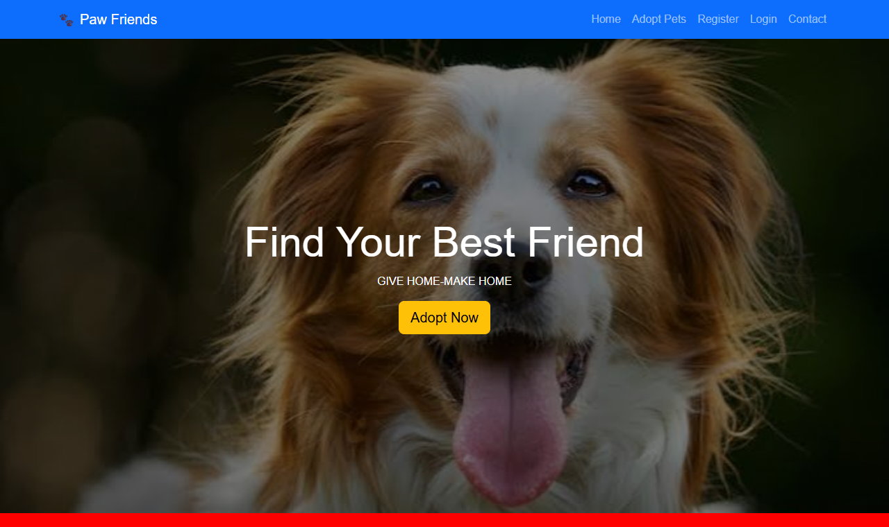
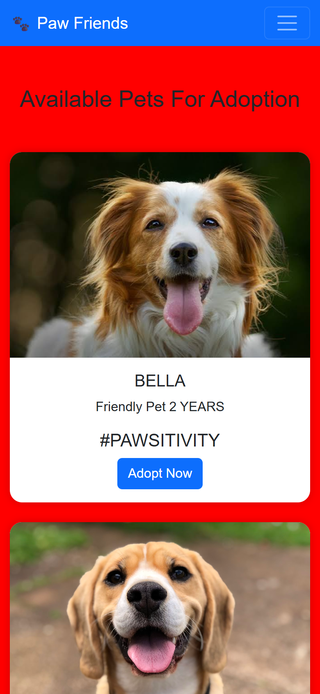

# 🐾 Paw Friends: Pet Adoption Website

A responsive 5-page website for a pet adoption shelter. Visitors can browse the pets waiting for a home, register, log in and contact the shelter, on a phone, tablet or laptop.

### 🌐 [Open it live](https://vineetsing9019.github.io/pet-adoption-website/)


<table>
  <tr>
    <td width="62%"></td>
    <td width="38%"></td>
  </tr>
  <tr>
    <td align="center">Home on a laptop</td>
    <td align="center">Adopt Pets on a phone</td>
  </tr>
</table>


## Pages

| Page | What it has |
|---|---|
| [Home](index.html) | Hero section ("Find Your Best Friend"), an Adopt Now button and a "Why Adopt?" section |
| [Adopt Pets](adoption.html) | 20 pet cards in a responsive grid: photo, name, age and an Adopt Now button |
| [Register](register.html) | Sign-up form |
| [Login](login.html) | Login form with an email field |
| [Contact](contact.html) | Contact form (required fields, email check) and an embedded Google Map of the shelter |

## How the layout works

One Bootstrap grid class gives the right number of cards on every screen, with no media queries of my own:

```html
<div class="row">
  <div class="col-lg-3 col-md-6 mb-4">   <!-- 4 per row on laptops, 2 on tablets, 1 on phones -->
    <div class="card"> ... </div>
  </div>
</div>
```

The navbar uses Bootstrap's `navbar-expand` + `navbar-collapse`, so on a phone the links fold into a ☰ menu button (see the phone screenshot).

## What I used

- **HTML5**: page structure, forms, input types (`email`) and `required` checks
- **CSS3**: custom styles in `style.css` (full-screen hero photo with a dark gradient overlay, centred with Flexbox; rounded form boxes)
- **Bootstrap 5**: navbar, grid, cards and buttons
- **Google Maps embed** (`iframe`) on the Contact page

## Run it locally

No install needed:

```bash
git clone https://github.com/Vineetsing9019/pet-adoption-website.git
cd pet-adoption-website
# open index.html in a browser
```

## What I learned

- Making one page work on every screen size with the Bootstrap grid (`col-lg-*`, `col-md-*`)
- A collapsible navbar for phones
- Building forms with the right input types and browser validation
- Keeping the same navbar and style across 5 pages
- Publishing a static site for free with GitHub Pages

## Next steps

- Save the forms to a real back end (my [PetHaven](https://github.com/Vineetsing9019/PetHaven) Spring Boot API already has register, login and adoption requests)
- Pet filters (dog, cat, bird) and a details page for each pet

## Author

**Vineetsing Girase**: Java Full Stack Developer, Badlapur, India
[GitHub](https://github.com/Vineetsing9019) · [Portfolio](https://vineetsing9019.github.io/portfolio/)
